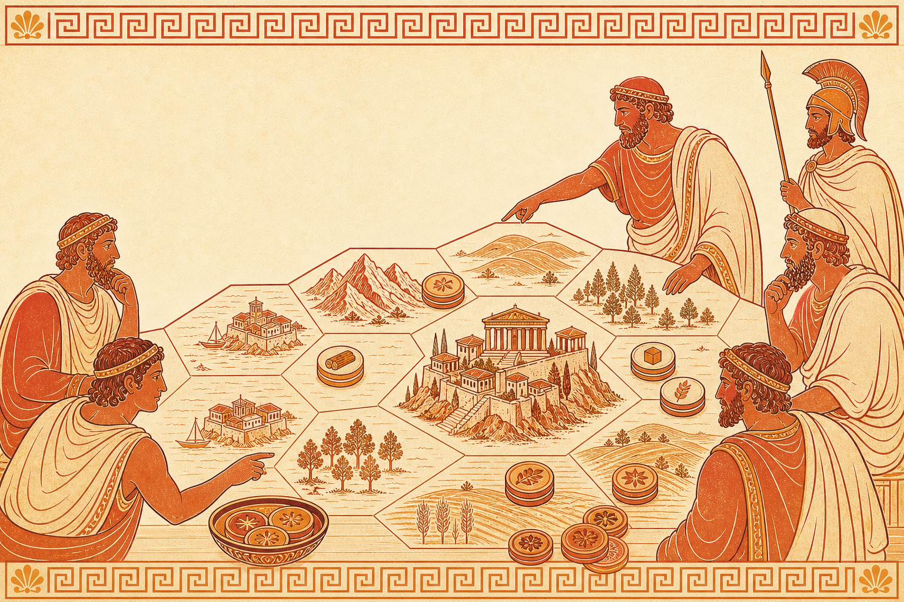

<div align="center">

# Hegemony

### Build a city-state. Command its people. Become the hegemon.

A strategy game for four players, set in an ancient Greek world of expansion,
scarcity, politics and shifting fortune.

</div>



Each player leads a city-state across a shared map of islands. Settle land, raise
cities, keep your people fed and content, trade with your rivals and pass Laws in the
Assembly. The winner is the first to hold three of six victory titles, not just the
richest.

## Game features

- **Board & Setup.** By default the board is an Archipelago of islands drawn fresh
  from the game seed; a continental landmass and a fixed authored map are options.
  Players place a capital and a founding colony in snake order, then draft one
  National Idea each. A game runs fourteen years, and each year turns a card that
  helps or hurts every realm.
- **Settlements.** Colonies hold up to 4 pops and work their tile's slots; cities and
  your capital hold 8 and raise buildings. Two rivals' colonies can share a tile and
  split its slots, and a Port on the coast claims a luxury good.
- **Resources.** Wood, stone, food, gold and influence. Slaves work the land, freemen
  make gold, citizens make influence, and every free pop eats a food. There is no
  bank: the Dole (3 influence for 1 food) is the only fixed exchange.
- **Pops.** Grow, move, promote and demote slaves, freemen and citizens. Slaves cost
  happiness, luxury goods and Temples restore it, and a realm that falls too low
  riots or revolts.
- **Trade.** On your turn, offer any mix of resources, luxury goods and pops to one
  rival or the whole table. Trade is the main way to turn what you have into what you
  need.
- **Assembly.** Every other year the players draw politicians' cards, propose Laws or
  repeals, and vote with one vote plus one per citizen. Up to four Laws stand at once
  and change the economy for everyone.
- **Victory.** Six titles (most cities, pops, citizens, gold, happiness and Laws
  authored) each go to the sole leader above a minimum. Hold three at the start of
  your turn to win; otherwise the most titles after the final year wins.

The full rules are in the [player guide](rules.md). In the game, the consult menu has
the Codex, every price on the Costs page and the race on the Victory page.

## Play locally

Four-player hotseat in a desktop browser with WebGL. Node.js 22 or newer.

```bash
npm install
npm run dev
```

Open the address Vite prints. URL options: `?board=continental` or `?board=scenario`
for another map, `?seed=N` to replay a setup, `?dev=bots` to watch bots play. On the
dev server, the TUNE panel (`?tune`) seats bots and adjusts balance values.

## Contributing

A React and TypeScript client over a deterministic rules engine in `src/game`; the UI
and the bots in `src/sim` only send commands and read projections. `npm start` opens
an [mprocs](https://github.com/pvolok/mprocs) dashboard with the dev server, type
checker and tests. Before a PR: `npm run check`, `npm run lint`, `npm run test:run`
and `npm run docs:check`. The [docs index](docs/README.md) holds the plans and open
questions, and the [simulation guide](docs/reference/simulation.md) covers headless
games and balance batches.

## Status

Playable today as local hotseat, with luxury goods, player trade and National Ideas
in. Next: the development deck replaces Ventures, then the
[agency package](docs/plans/agency-package.md) (a year forecast, optional event pops,
bulk buys, Port-held goods), then balance and networked multiplayer.
